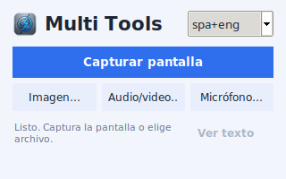
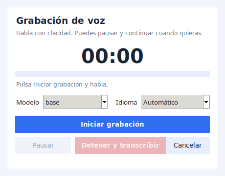

# Multi Tools

<p align="center">
  
</p>

Aplicación de escritorio para Linux que reúne tres herramientas en una ventana
compacta:

- **OCR**: extrae texto de capturas de pantalla o imágenes.
- **Transcripción**: convierte audio y video en texto con Whisper.
- **Micrófono**: graba voz (iniciar, pausar, reanudar y detener) y la transcribe.

Todo el texto resultante se puede editar, **copiar al portapapeles**, guardar como
`.txt` o volver a consultar desde la ventana principal.

<p align="center">
  
  
</p>

## Funcionalidades

### OCR de capturas e imágenes

- **Capturar pantalla**: congela la pantalla y permite arrastrar para seleccionar
  cualquier área. Al soltar, la selección queda marcada y aparece un panel con
  **Repetir** y **Confirmar**. También se confirma con `Enter` y se cancela con `Esc`.
- **Imagen…**: abre el selector de archivos para elegir una imagen del disco.
- Idiomas OCR: `spa+eng` (predeterminado), `spa` y `eng`.
- Formatos de imagen: PNG, JPG/JPEG, JFIF, BMP, TIFF, WEBP, AVIF, HEIC/HEIF e ICO.
- Texto editable con opciones de copiar, guardar y limpiar.

### Transcripción de audio y video

- Formatos habituales: MP3, WAV, M4A, AAC, OGG/OPUS, FLAC, WMA, AIFF, MP4, MKV,
  MOV, AVI, WEBM, MPEG, 3GP, MTS, TS, ASF y más.
- Detección **automática del idioma** (también se puede fijar español, inglés,
  portugués, francés, alemán o italiano).
- Modelos: `tiny`, `base` (predeterminado), `small`, `medium` y `large-v3`.
- Optimizado para CPU: cuantización `int8`, `beam_size=1`, todos los hilos
  disponibles. En este equipo un audio de 1 minuto tarda unos 10 segundos con `base`.
- El modelo se descarga la primera vez y queda en la caché local.
- Progreso en la barra de estado mientras se transcribe.

### Grabación con micrófono

- Grabadora integrada con **Iniciar grabación**, **Pausar**, **Reanudar** y
  **Detener y transcribir**.
- Temporizador y medidor de nivel de audio en tiempo real.
- Selección de modelo e idioma antes de grabar.
- El audio se guarda temporalmente en WAV, se transcribe y el temporal se elimina.
- Si la grabación dura menos de un segundo, se descarta y se puede repetir.

### Selector de archivos propio

- Lista los archivos **del más reciente al más antiguo** por defecto.
- Ordenación por fecha, nombre o tamaño (ascendente y descendente).
- Búsqueda por nombre en la carpeta actual o en **subcarpetas**.
- Navegación con **Subir**, **Descargas**, **Inicio** o escribiendo la ruta.
- Empieza en la carpeta de **Descargas** la primera vez y recuerda el último
  directorio usado entre sesiones.

### Ventana de resultado

- Texto editable con contador de caracteres.
- **Copiar texto** al portapapeles.
- **Guardar .txt** con nombre basado en fecha y hora.
- **Limpiar** el contenido.
- Si cierras la ventana, el texto se conserva en memoria y se recupera con
  **Ver texto** en la ventana principal.

## Requisitos

- Linux. Probado en **Ubuntu 24.04 con X11**.
- Python 3.12 para ejecutar desde el código fuente (probado en Ubuntu 24.04).
- Micrófono disponible en el sistema (PipeWire, PulseAudio o ALSA) para la grabación.
- Conexión a Internet la primera vez que se usa un modelo de Whisper.
- No se necesita `sudo` para la instalación de desarrollo: `setup.sh` descarga Tk,
  Tesseract, sus idiomas y PortAudio como paquetes `.deb` dentro de `.vendor/`.

> La captura de pantalla usa X11 (`ImageGrab`). En Wayland puede depender del
> compositor o funcionar a través de XWayland.

## Instalación

### Opción A: paquete `.deb` (uso normal)

Si ya tienes el paquete compilado:

```bash
sudo apt install ./multi-tools_1.1.0_amd64.deb
```

Se instala en `/opt/multi-tools` y crea el acceso **Multi Tools** en el menú de
aplicaciones con su icono. Para desinstalarlo:

```bash
sudo apt remove multi-tools
```

Los artefactos compilados (`.deb` y `.tar.gz`) no se versionan en Git por su tamaño;
se generan localmente con `./build_release.sh` (ver [Producción](#producción)).

### Opción B: portable

```bash
tar -xzf MultiTools-1.1.0-linux-x86_64.tar.gz
./MultiTools/MultiTools
```

### Opción C: desde el código fuente (desarrollo)

```bash
git clone https://github.com/wmcarlosv/multi-tools.git
cd multi-tools
./setup.sh
./run.sh
```

`setup.sh`:

1. Descarga Tkinter, Tcl/Tk, Tesseract, los idiomas OCR y PortAudio en `.vendor/`.
2. Crea el entorno virtual `.venv/`.
3. Instala las dependencias Python de `requirements.txt`.

Opcionalmente, para crear un acceso de desarrollo en el menú:

```bash
./install_launcher.sh
```

## Uso

Al abrir la aplicación verás una ventana compacta de 320x200 con:

- **Capturar pantalla**: selecciona el área, pulsa **Confirmar** o `Enter`.
- **Imagen…**: elige una imagen con el selector integrado.
- **Audio/video…**: elige un archivo multimedia y después el modelo e idioma.
- **Micrófono…**: inicia la grabación, pausa/reanuda si lo necesitas y pulsa
  **Detener y transcribir**.
- **Ver texto**: recupera el último resultado si cerraste su ventana.

El idioma OCR se elige en la esquina superior derecha de la ventana principal.
El resultado se abre en una ventana aparte para copiar o guardar el texto.

### Atajos y controles

| Acción | Control |
| --- | --- |
| Confirmar área de captura | `Enter` o botón **Confirmar** |
| Cancelar captura/grabación | `Esc` |
| Repetir selección de captura | Botón **Repetir** |
| Pausar/Reanudar grabación | Botón **Pausar/Reanudar** |
| Detener y transcribir | Botón **Detener y transcribir** |
| Buscar archivo | Campo **Buscar** del selector |
| Buscar en subcarpetas | Casilla **Subcarpetas** |
| Copiar/Guardar/Limpiar resultado | Botones de la ventana **Resultado** |

## Modelos de Whisper

| Modelo | Tamaño aproximado | Velocidad | Calidad |
| --- | --- | --- | --- |
| `tiny` | ~75 MB | Muy rápida | Básica |
| `base` | ~145 MB | Rápida (predeterminado) | Buena |
| `small` | ~466 MB | Media | Muy buena |
| `medium` | ~1.5 GB | Lenta | Alta |
| `large-v3` | ~3.1 GB | Muy lenta en CPU | Máxima |

Los modelos se descargan desde Hugging Face la primera vez y se guardan en
`~/.cache/huggingface/`. Después del primer uso funcionan sin conexión.

## Diagnóstico y línea de comandos

Tanto `./run.sh` como el ejecutable compilado admiten:

```bash
./run.sh --check                     # Comprueba OCR, idiomas, Whisper y micrófono
./run.sh --ocr imagen.png            # Extrae texto sin abrir la interfaz
./run.sh --transcribe audio.ogg      # Transcribe con el modelo predeterminado
./run.sh --transcribe video.mp4 base # Transcribe con un modelo concreto
./run.sh --record 10                 # Graba 10 s del micrófono y transcribe
```

`--check` es útil para verificar que Tesseract, los idiomas y PortAudio están
disponibles antes de usar la aplicación.

## Configuración y datos

| Dato | Ubicación |
| --- | --- |
| Último directorio usado | `~/.config/multi-tools/settings.json` |
| Modelos de Whisper | `~/.cache/huggingface/` |
| Grabaciones temporales | Archivo WAV temporal en `/tmp`, eliminado tras transcribir |
| Configuración de la app | No requiere configuración adicional |

La aplicación no envía datos a ningún servidor propio ni incluye telemetría. La única
conexión de red es la descarga de modelos desde Hugging Face la primera vez.

## Producción

El código de desarrollo vive en la raíz del proyecto. La versión compilada se genera
aparte, en `dist/` y `release/` (ignorados por Git):

```bash
./build_release.sh
```

Genera:

- `release/multi-tools_1.1.0_amd64.deb`: paquete instalable.
- `release/MultiTools-1.1.0-linux-x86_64.tar.gz`: versión portable.

La compilación con PyInstaller incluye Python, Tk, Tesseract, los idiomas OCR,
PortAudio y las librerías necesarias. Los modelos de Whisper no se incluyen: se
descargan la primera vez.

## Estructura del proyecto

```
app.py                   Punto de entrada, entorno y modos CLI
multi_tools/
  config.py              Rutas de Tesseract/Tk/icono (desarrollo y compilado)
  ocr.py                 Extracción de texto con Tesseract
  transcribe.py          Transcripción con faster-whisper
  microphone.py          Grabación con PortAudio y escritura de WAV
  settings.py            Persistencia del último directorio usado
  ui.py                  Interfaz Tkinter, diálogos y selector de archivos
assets/
  multi-tools.png        Icono transparente de la aplicación
  screenshots/           Capturas para la documentación
setup.sh                 Instalación de desarrollo sin sudo
install_launcher.sh      Lanzador de desarrollo en el menú
run.sh                   Lanzador de desarrollo
build_release.sh         Compilación de producción (.deb y portable)
multi-tools.spec         Configuración de PyInstaller
requirements.txt         Dependencias de ejecución
requirements-build.txt   Dependencias de compilación
```

Directorios generados y excluidos de Git: `.venv/`, `.vendor/`, `.cache/`,
`__pycache__/`, `.build/`, `dist/` y `release/`.

## Solución de problemas

- **No aparece el micrófono o error de PortAudio**: ejecuta `./setup.sh` para
  descargar PortAudio en `.vendor/` y comprueba los dispositivos con
  `./run.sh --check`.
- **No se detecta texto en una imagen**: prueba con `spa+eng`, asegúrate de que la
  imagen tiene texto legible y buena resolución.
- **La transcripción tarda**: usa `tiny` o `base`, o un archivo más corto. La primera
  vez incluye la descarga del modelo.
- **No descarga el modelo**: comprueba la conexión a Internet y el espacio libre en
  `~/.cache/huggingface/`.
- **La captura sale vacía en Wayland**: usa una sesión X11 o el selector de imágenes.
- **El icono del menú no se actualiza**: cierra sesión y vuelve a entrar para limpiar
  la caché de GNOME.
- **El portapapeles se pierde al cerrar**: el portapapeles de X11 lo mantiene la
  aplicación mientras está abierta; pega el texto o guárdalo como `.txt` antes de
  cerrarla.

## Tecnologías

- [Tkinter](https://docs.python.org/3/library/tkinter.html) para la interfaz.
- [Tesseract OCR](https://github.com/tesseract-ocr/tesseract) para el texto de imágenes.
- [faster-whisper](https://github.com/SYSTRAN/faster-whisper) y
  [CTranslate2](https://github.com/OpenNMT/CTranslate2) para la transcripción.
- [PyAV](https://github.com/PyAV-Org/PyAV) para decodificar audio/video.
- [Pillow](https://python-pillow.org/) para imágenes y capturas.
- [PortAudio](https://www.portaudio.com/) mediante `sounddevice` para el micrófono.
- [PyInstaller](https://pyinstaller.org/) para la compilación.

## Estado

Versión actual: **1.1.0**. Probado en Ubuntu 24.04 (X11) con OCR en español/inglés,
transcripción de OGG/MP4 y grabación desde micrófono.
